# 🍽️ Emperor Cuisine Restaurant Enterprise BI Platform
### 24-Page Multi-Branch Commercial & Operational Analytics Suite | Power BI • Star Schema Data Modeling • DAX • Omnichannel Attribution • AI Sentiment Analysis
**Stack:** Microsoft Power BI · Power Query (M) · DAX Time Intelligence · Star Schema (11 Dims + 12 Facts) · Theme JSON

[](https://powerbi.microsoft.com/)
[](https://learn.microsoft.com/en-us/dax/)
[-blue?style=for-the-badge)]()
[]()

---

## 📌 Executive Summary
In multi-branch restaurant enterprise management, profitability hinges on synchronizing operations across disparate business pillars: POS sales registers, dining reservations, loyalty memberships, digital lead channels, kitchen food costs, and front-of-house staff service.

This project delivers an enterprise-grade **24-Page Power BI Business Intelligence System** built for **Emperor Cuisine Restaurant Group**, a multi-branch dining enterprise operating across 5 flagship locations in Malaysia (**Kuala Lumpur / KL, Klang, Cheras, Puchong, and Subang**). Driven by an in-memory Star Schema model consolidating **11 Dimension Tables and 12 Fact Tables**, the platform tracks:
- **Commercial Performance:** **RM20.69M in Total Sales**, outperforming the **RM20.00M annual target (103.5% achievement)**.
- **Dining Reservations:** **12,698 Bookings** (9,143 confirmed, 72.0% conversion rate) with peak capacity analysis.
- **High-Ticket Operations:** **RM3.11M VIP Room Revenue**, **RM3.12M VVIP Revenue**, and **RM4.45M Event Revenue**.
- **Customer Loyalty & Wallet:** **8,000 Members** driving **RM12.45M in Member Sales (60.2% contribution)**, **RM1.45M in Wallet Top-Ups**, and 47.2% voucher redemption.
- **Omnichannel Attribution:** 10 digital platforms tracking **63M views**, **12,223 enquiries**, and **8,774 attributed bookings (71.8% attributed rate)**.
- **AI Automation:** **16,500 Customer Conversations** handled by conversational AI at a **78.3% automated success rate** and 15.37-second average latency.
- **Actionable Governance:** Prioritized **Management Action Plan** identifying **RM799,562 in revenue recovery opportunities**.

---

## 🖥️ 24-Page Interactive Power BI Dashboard Suite

The suite utilizes a custom corporate palette (`Emperor_Cuisine_PowerBI_Theme.json`) featuring rich imperial burgundy, ivory containers, warm gold data accents, and structured side-panel navigation.

```text
┌────────────────────────────────────────────────────────────────────────────────────────┐
│                                 24-PAGE DASHBOARD MAP                                  │
├───────────────────────────────────┬────────────────────────────────────────────────────┤
│ Module 1: Target & Branches (P1-3)│ Overview • RM20M Target • Branch Performance       │
│ Module 2: Sales Dynamics (P4-5)   │ Daily Sales 1 (Trend) • Daily Sales 2 (Dayparts)   │
│ Module 3: Promo & Margins (P6-7)  │ Promo Performance 1 • Promo Efficiency & Margin 2  │
│ Module 4: Menu Engineering (P8-9) │ Menu Sales 1 (Volume) • Dish Profitability 2       │
│ Module 5: Bookings & VIP (P10-12) │ Booking 1 (Pax) • Booking 2 (Slots) • VIP & Events │
│ Module 6: Loyalty & Wallet (P13-15│ Membership • Wallet 1 (Flows) • Wallet 2 (Dormancy)│
│ Module 7: Omnichannel (P16-19)    │ 10-Platform Overview • Scores • Attribution 1 & 2  │
│ Module 8: AI Auto-Reply (P20)     │ AI Success • Human Takeover • Topic Hotspots       │
│ Module 9: Staff Productivity (P21)│ Staff Upsell Champions • Revenue per Shift Matrix  │
│ Module 10: Reviews & CSAT (P22)   │ Sentiment Analysis • Complaint Categorization      │
│ Module 11: Action & Growth (P23-24│ Forecast & Growth • Prioritized Action Plan        │
└───────────────────────────────────┴────────────────────────────────────────────────────┘
```

---

### Module 1: Executive Sales & Target Tracking (Pages 1–3)

#### 1️⃣ Page 1 — Executive Overview
*High-level executive cockpit tracking gross revenue (RM20.69M), target progress, daily run rate, booking health, and digital platform pipeline.*
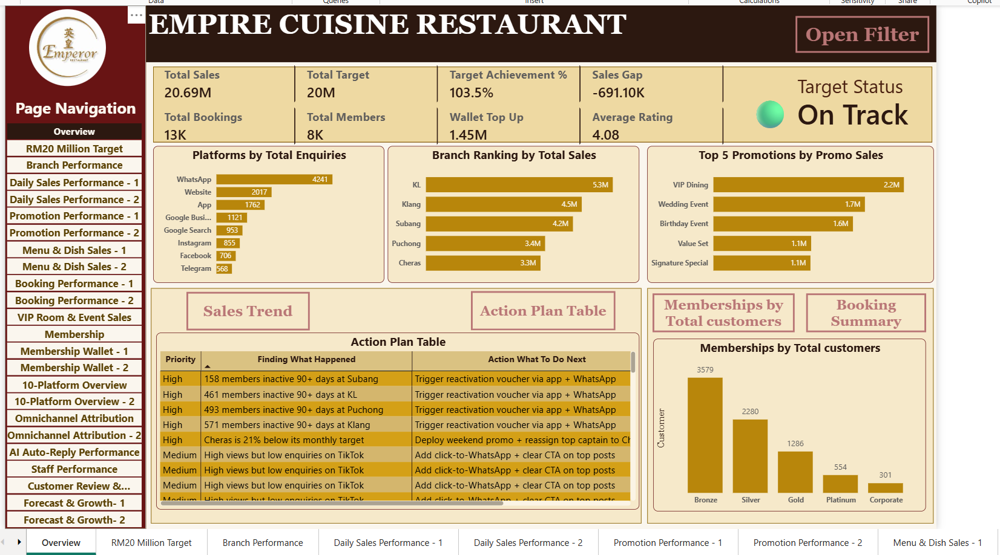

#### 2️⃣ Page 2 — RM20 Million Annual Target
*Monthly target pacing chart, cumulative year-to-date tracking, branch achievement breakdown, and daily required run-rate calculations.*
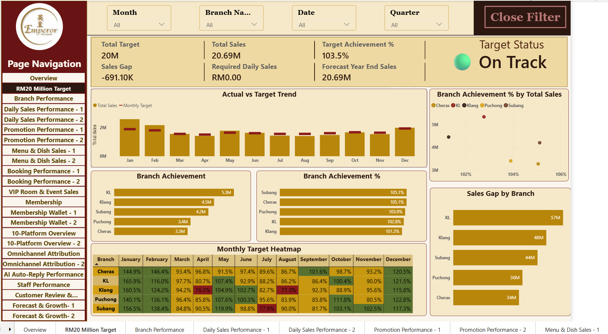

#### 3️⃣ Page 3 — Branch Performance Scorecard
*Multi-dimensional branch benchmarking comparing KL, Klang, Subang, Puchong, and Cheras across revenue, average check value, and service rating.*
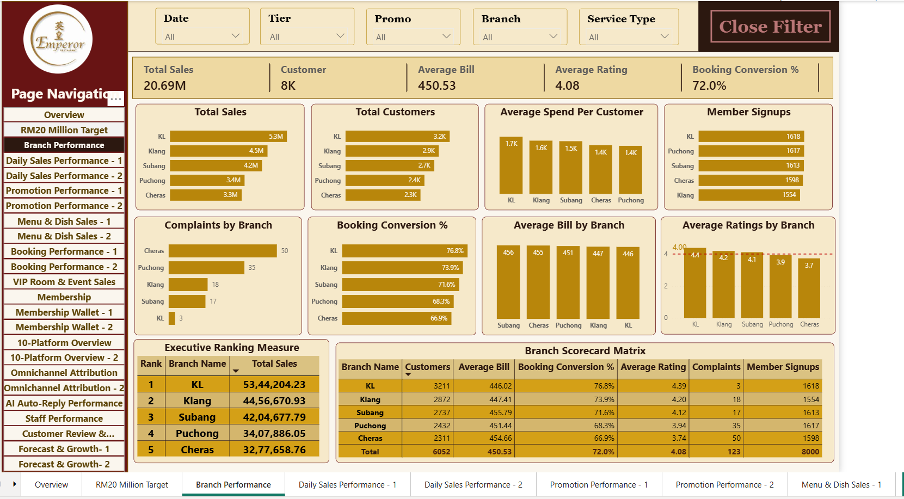

---

### Module 2: Daily Sales Dynamics & Daypart Analytics (Pages 4–5)

#### 4️⃣ Page 4 — Daily Sales Performance - 1 (Daily Trends)
*Daily revenue variance against daily weighted targets, weekday vs. weekend spikes, and monthly trading day analyses.*
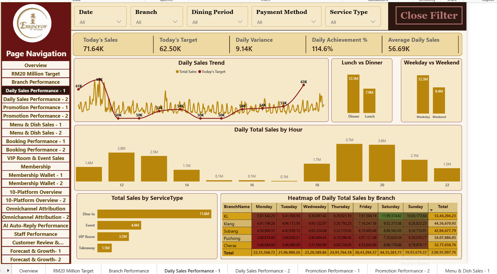

#### 5️⃣ Page 5 — Daily Sales Performance - 2 (Daypart & Hourly Heatmaps)
*Granular operational sales heatmaps tracking peak lunch (12:00–13:00) vs. dinner rush (19:00–20:00) demand across operating hours.*
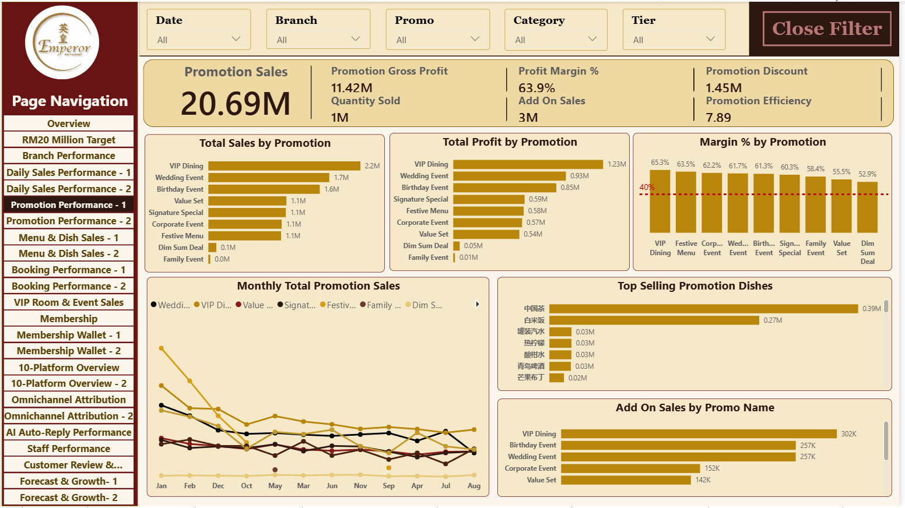

---

### Module 3: Promotion Performance & Margin Efficiency (Pages 6–7)

#### 6️⃣ Page 6 — Promotion Performance - 1 (Volume & Revenue)
*Enquiry-to-booking conversions across promotional packages (Birthday, Wedding, Corporate, Dim Sum Deals).*
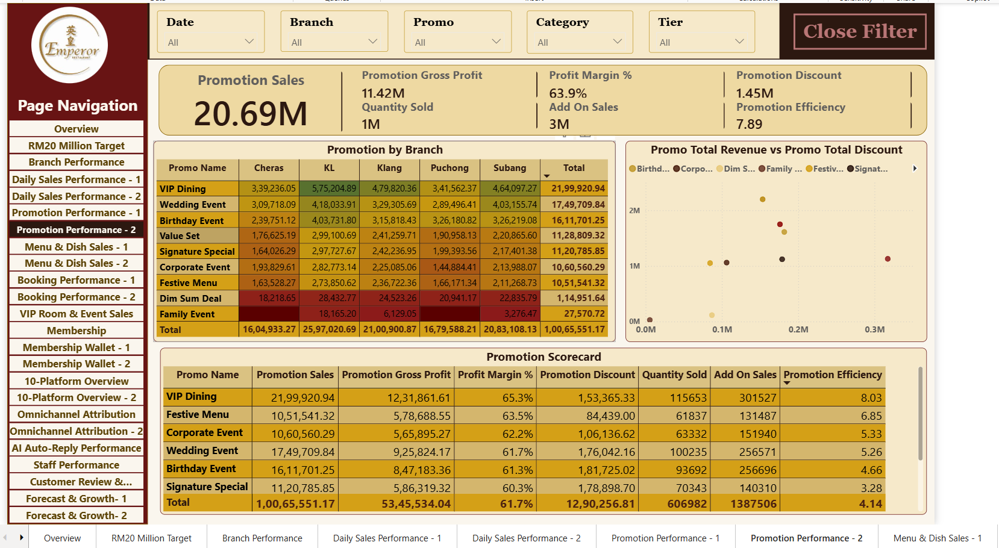

#### 7️⃣ Page 7 — Promotion Performance - 2 (Discount & Margin Audit)
*Auditing promotional discount depth vs. gross margin yield to identify margin-diluting promotions (e.g., RM3 Dim Sum offer).*
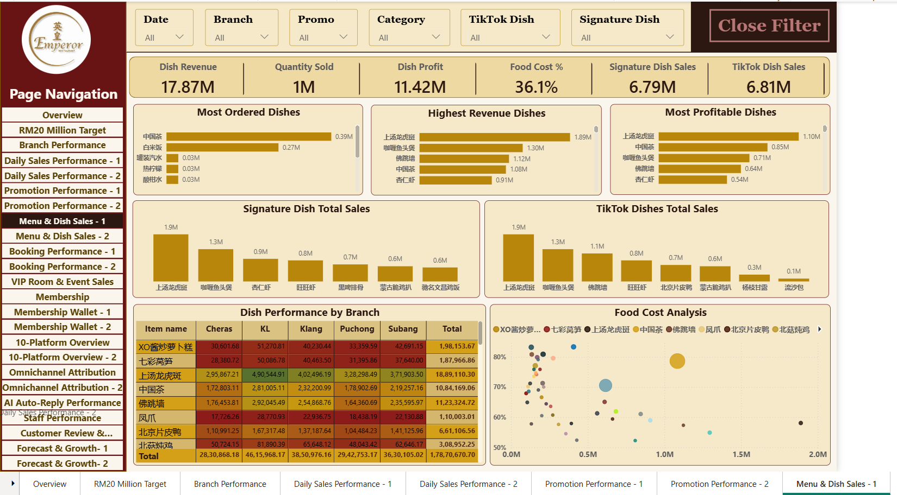

---

### Module 4: Menu Engineering & Dish Profitability (Pages 8–9)

#### 8️⃣ Page 8 — Menu & Dish Sales - 1 (Volume & Revenue Rankings)
*Sales volume rankings across 320+ order items, identifying top signature revenue drivers and TikTok-viral dishes.*
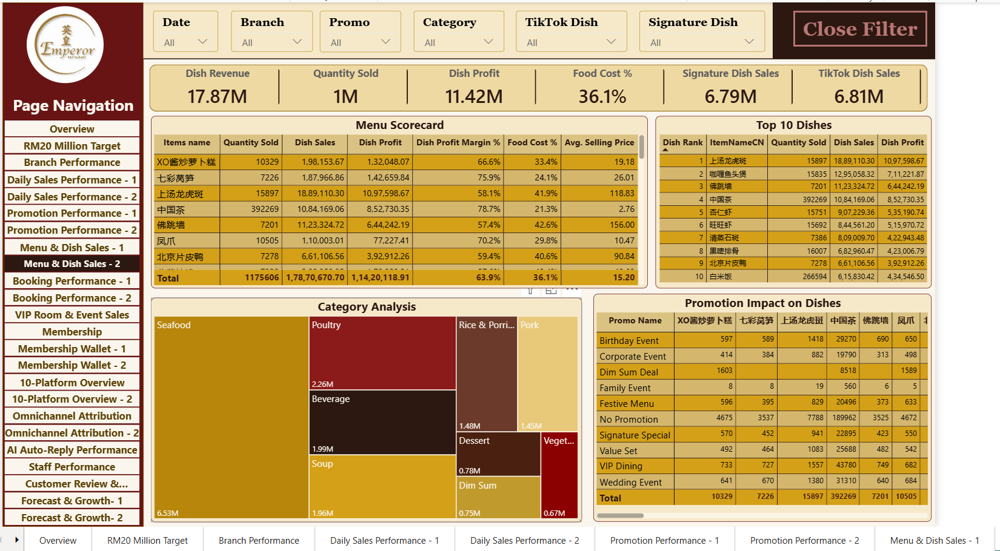

#### 9️⃣ Page 9 — Menu & Dish Sales - 2 (Food Cost & Margin Matrix)
*Recipe-level food cost (COGS %) analysis against selling price to isolate high-margin stars and low-yield menu items.*
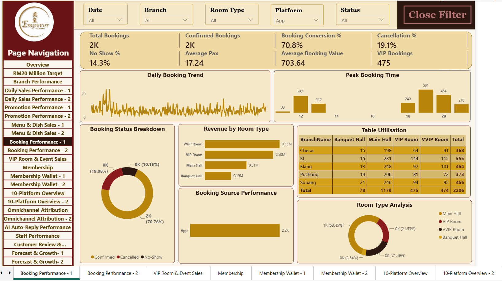

---

### Module 5: Table & Room Booking Intelligence (Pages 10–12)

#### 🔟 Page 10 — Booking Performance - 1 (App Platform Focus)
*Party size (Pax), confirmation rates, cancellation tracking, and room distribution under mobile app reservation channels.*
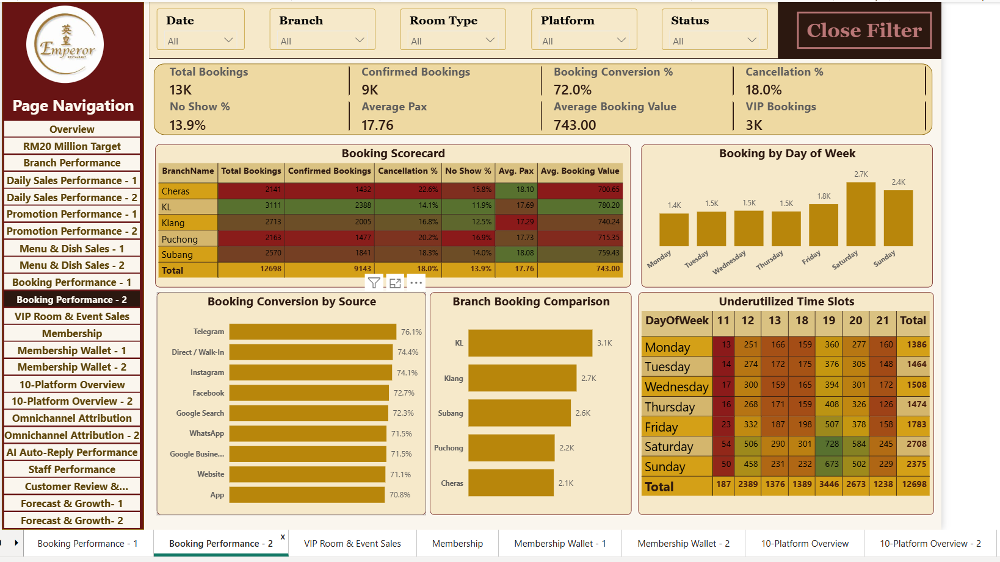

#### 1️⃣1️⃣ Page 11 — Booking Performance - 2 (Branch Demand & Slot Matrix)
*Comprehensive booking demand heatmap across all 7 days of the week and all operating hours, highlighting underutilized weekday slots.*
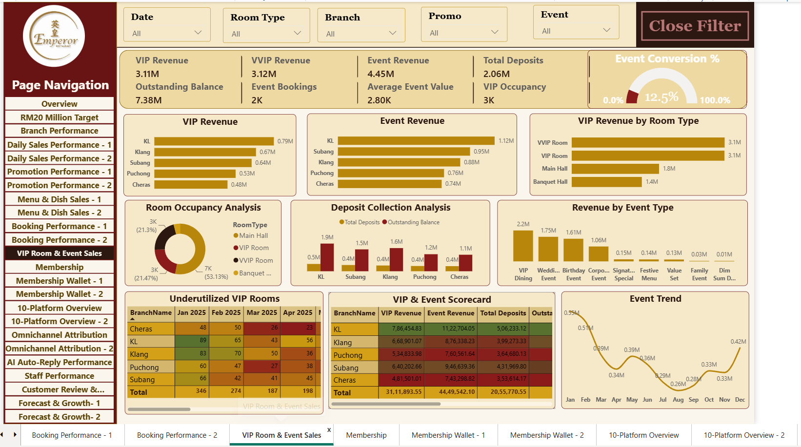

#### 1️⃣2️⃣ Page 12 — VIP Room & Event Sales
*High-ticket revenue tracking across VVIP and VIP private dining rooms, banquet reservations, corporate bookings, and deposit collection.*
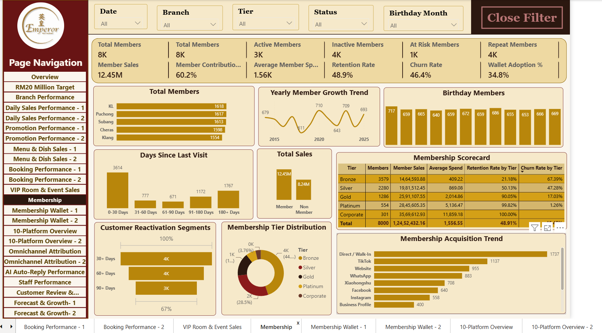

---

### Module 6: Membership & Wallet Liquidity (Pages 13–15)

#### 1️⃣3️⃣ Page 13 — Membership Analytics & Tier Distribution
*Customer lifecycle segmentation tracking 8,000 members across Bronze, Silver, Gold, Platinum, and Corporate tiers, plus retention/churn.*
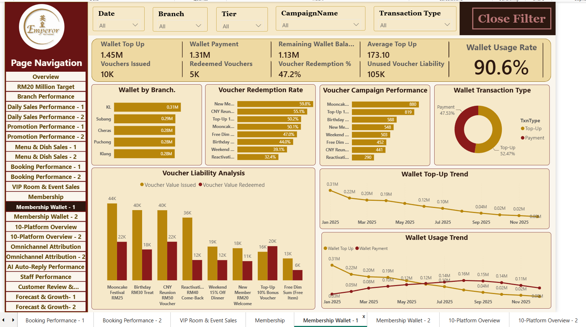

#### 1️⃣4️⃣ Page 14 — Membership Wallet - 1 (Top-Ups & Usage)
*Digital wallet cash-in vs. cash-out liquidity flows (RM1.45M top-ups / RM1.31M spent), voucher redemption rate, and remaining balance.*
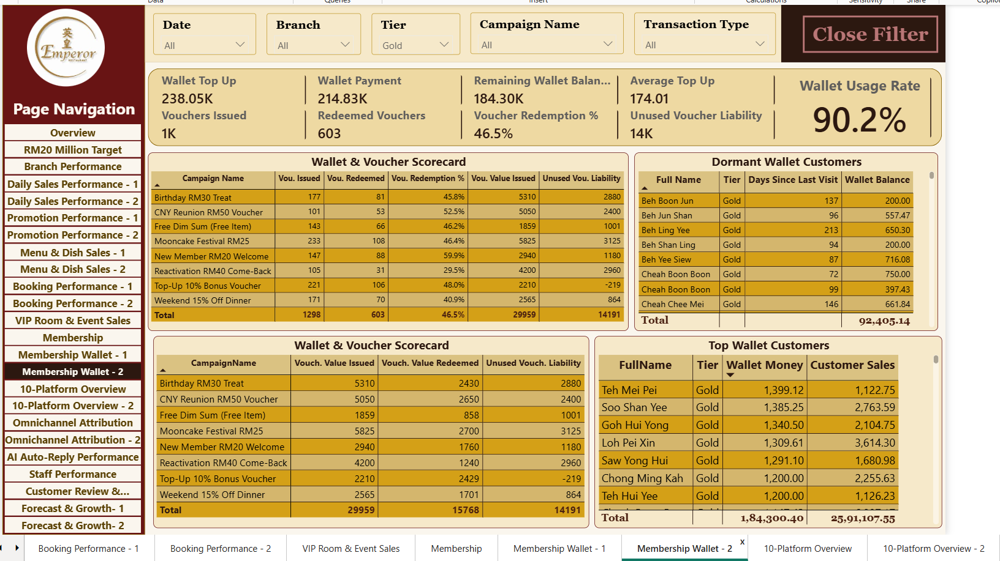

#### 1️⃣5️⃣ Page 15 — Membership Wallet - 2 (Dormancy & Liability)
*Tier-filtered wallet dormancy analysis isolating inactive customers with unspent stored balances (>RM92K in Gold tier).*
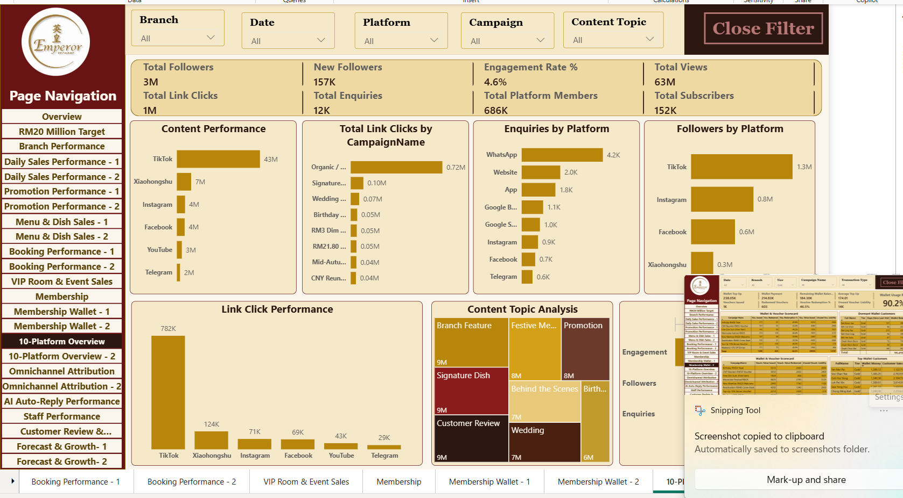

---

### Module 7: Digital Platforms & Omnichannel Attribution (Pages 16–19)

#### 1️⃣6️⃣ Page 16 — 10-Platform Digital Overview - 1
*Macro digital marketing dashboard consolidating 10 channels (TikTok, Instagram, WhatsApp, Google Search, Facebook, etc.) with 63M views.*
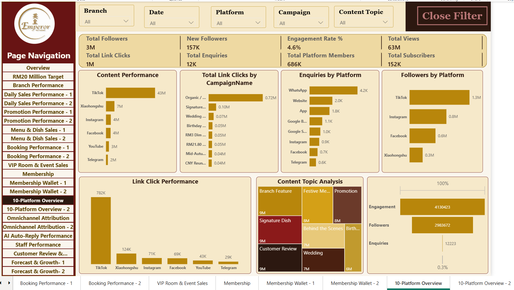

#### 1️⃣7️⃣ Page 17 — 10-Platform Digital Overview - 2 (Branch Filtering)
*Branch-specific lead generation and channel comparison scorecards evaluating audience engagement and inquiry volumes.*
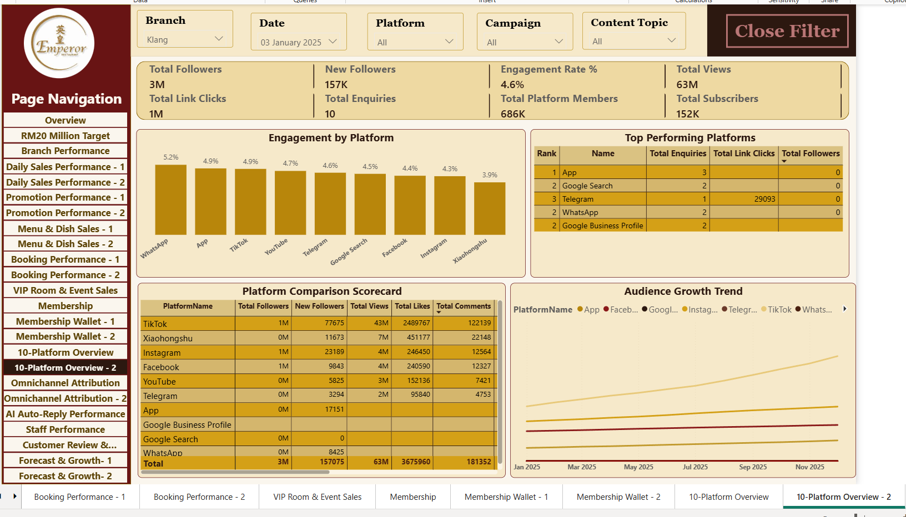

#### 1️⃣8️⃣ Page 18 — Omnichannel Attribution - 1 (Funnel Diagnostics)
*Tracking digital customer journeys from initial platform impression and link click down to qualified enquiry and confirmed dining booking.*
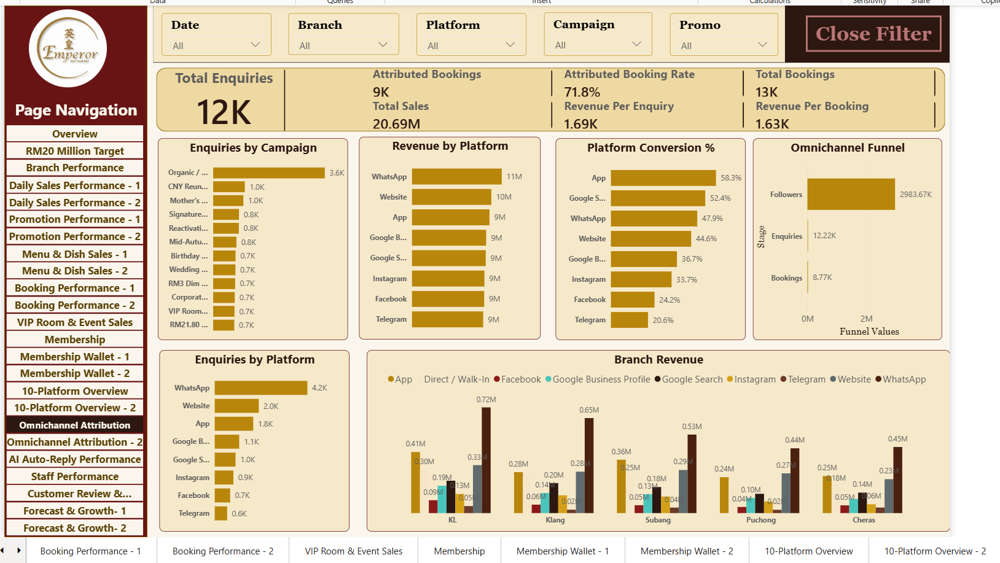

#### 1️⃣9️⃣ Page 19 — Omnichannel Attribution - 2 (Campaign ROI Quadrant)
*Attributing sales revenue across campaigns and promotional codes, highlighting WhatsApp and Website conversion supremacy.*
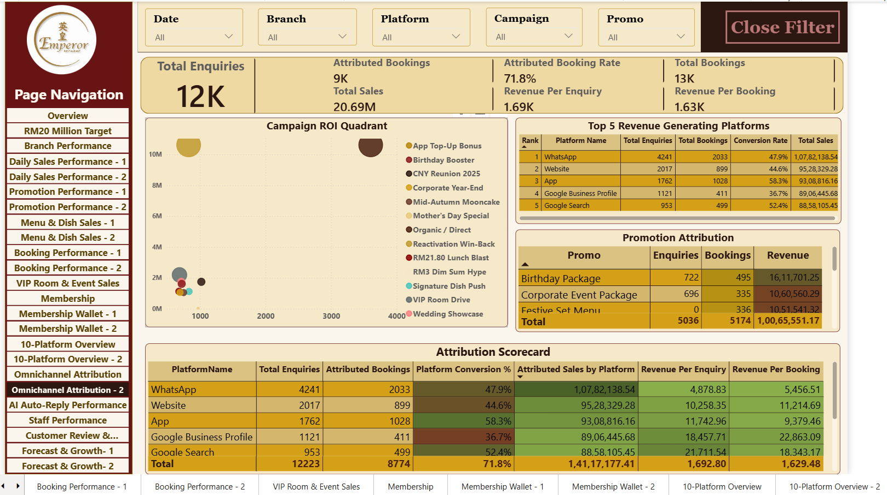

---

### Module 8: AI Customer Service Automation (Page 20)

#### 2️⃣0️⃣ Page 20 — AI Auto-Reply Performance
*Automated conversational AI analytics tracking 16,500 conversations, topic-level success rates (78.3%), human takeovers, and booking conversions.*
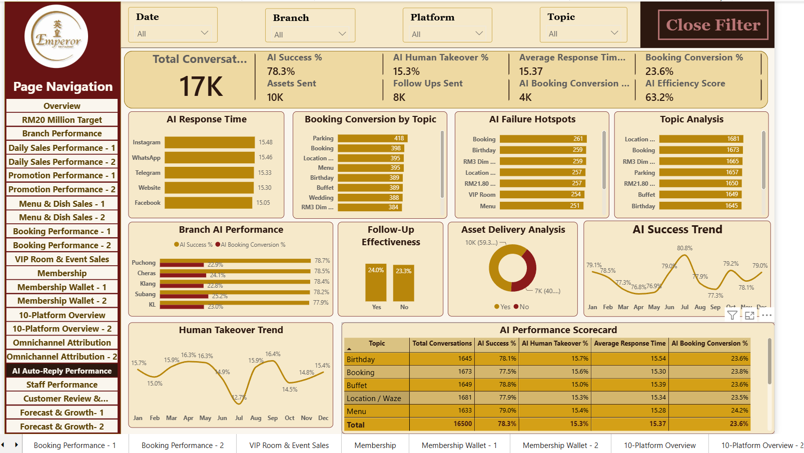

---

### Module 9: Workforce & Staff Upselling Productivity (Page 21)

#### 2️⃣1️⃣ Page 21 — Staff Performance & Upsell Champions
*Individual staff contribution benchmarks across bill volume, upsell attachment (RM3.64M total upsells), member acquisitions, and reviews.*
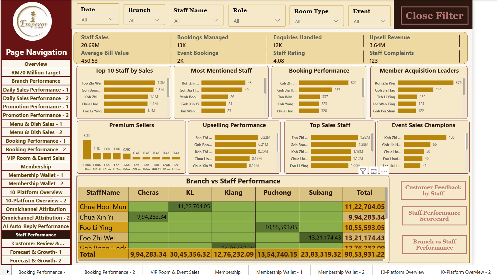

---

### Module 10: Customer Experience & Sentiment Analytics (Page 22)

#### 2️⃣2️⃣ Page 22 — Customer Review & Satisfaction Diagnostics
*Natural language sentiment analysis of 3,703 reviews, dish keyword mentions, staff praise, and branch complaint rates (Cheras alert).*
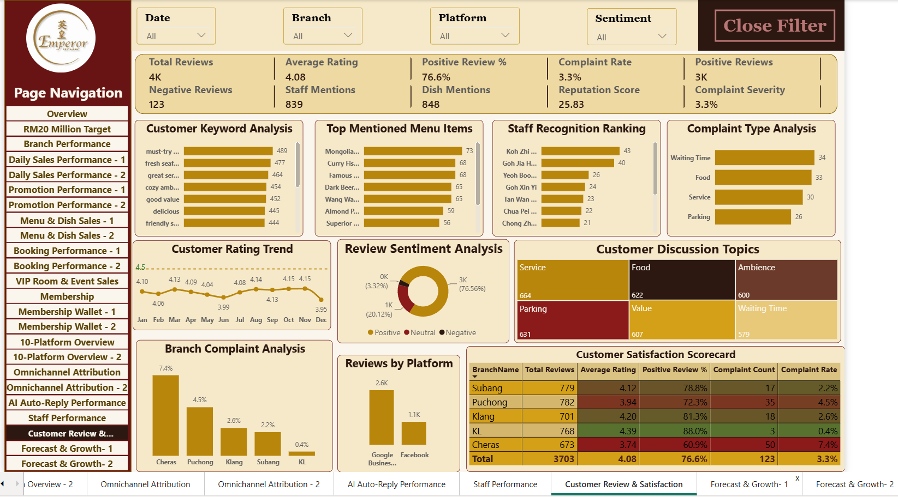

---

### Module 11: Forecasting & Executive Action Plan (Pages 23–24)

#### 2️⃣3️⃣ Page 23 — Forecast & Growth - 1 (Year-End Run Rate)
*Full-year projection model confirming RM20.69M year-end achievement with surplus margin, branch gap analyses, and capacity upside.*
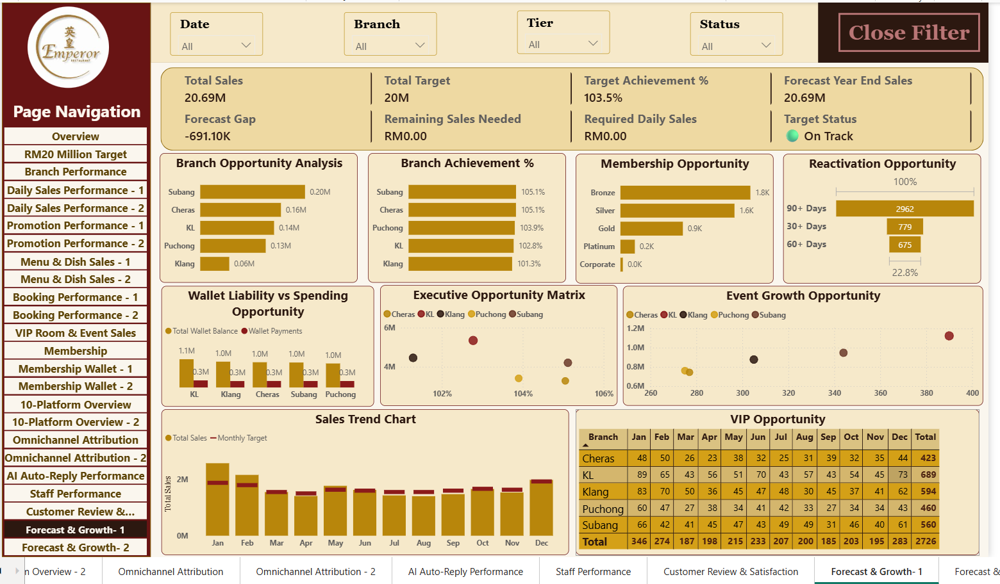

#### 2️⃣4️⃣ Page 24 — Forecast & Growth - 2 (Prioritized Management Action Plan)
*Management action matrix prioritizing operational initiatives with expected RM revenue recoveries across Utilisation, Traffic, and Margin.*
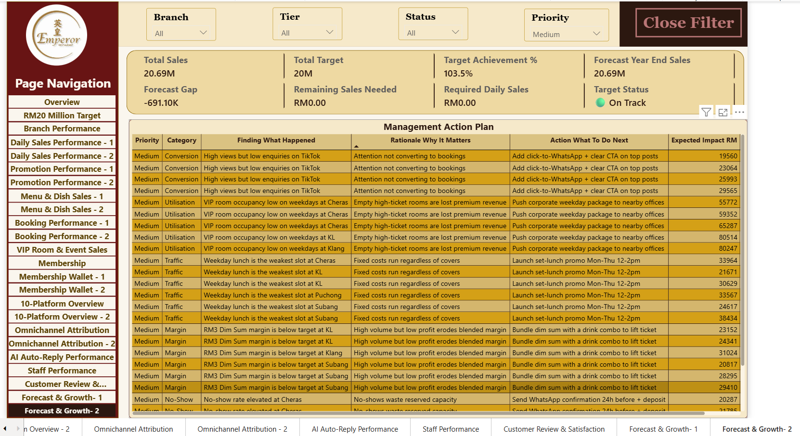

---

## 📊 Core Enterprise KPI Snapshot

| Metric Dimension | Key Performance Indicator (KPI) | Analytical Value | Strategic Interpretation |
| :--- | :--- | :--- | :--- |
| **Gross Revenue** | **Total Sales (All Outlets)** | **RM20,691,100 (RM20.69M)** | Full-year gross restaurant sales |
| **Commercial Target** | **Annual Weighted Target** | **RM20,000,000 (RM20.00M)** | Board-approved corporate target |
| **Target Achievement** | **Achievement Percentage** | **103.5% (🟢 On Track)** | Target exceeded by +RM691.10K |
| **Dining Volume** | **Total Reservations / Bookings** | **12,698 bookings** | Table & event bookings logged |
| **Reservation Yield** | **Booking Conversion Rate** | **72.0% (9,143 confirmed)** | Confirmation efficiency |
| **Operational Losses** | **Cancellation / No-Show Rate** | **18.0% / 13.9%** | Primary operational table leakage |
| **Average Ticket** | **Average Bill Value (Overall)** | **RM450.53 / check** | High-value dining basket size |
| **VIP Room Revenue** | **VIP + VVIP Private Dining** | **RM6,230,000 (RM6.23M)** | 30.1% of total enterprise sales |
| **Event Operations** | **Banquets, Weddings & Corporate** | **RM4,450,000 (RM4.45M)** | Large-party dining revenue |
| **Loyalty Base** | **Total Registered Members** | **8,000 members** | 60.2% share of gross sales (RM12.45M) |
| **Wallet Liquidity** | **Top-Ups / Net Balance** | **RM1.45M / RM1.13M** | Prepaid cash float & working capital |
| **Digital Footprint** | **Audience Reach / Views** | **3.0M followers / 63M views** | Gross top-of-funnel brand visibility |
| **Lead Generation** | **Digital Inquiries / Attribution** | **12,223 enquiries (71.8% attr)** | Inbound messaging conversion |
| **AI Efficiency** | **AI Automated Reply Success** | **78.3% (15.37s response time)**| Automated customer query resolution |
| **Customer CSAT** | **Average Review Rating** | **4.08 / 5.00 (76.6% positive)**| Quality score across 3,703 reviews |

---

## 🏗️ Data Architecture & Star Schema Model

The data model is engineered around Kimball dimensional modeling principles, linking **11 Dimension Tables** to **12 Specialized Fact Tables** with clean one-to-many relationships and single-direction filter propagation:

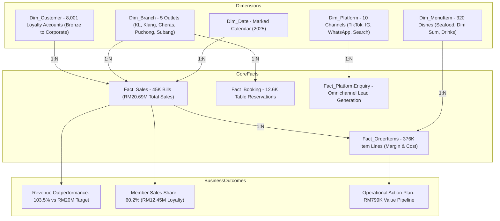

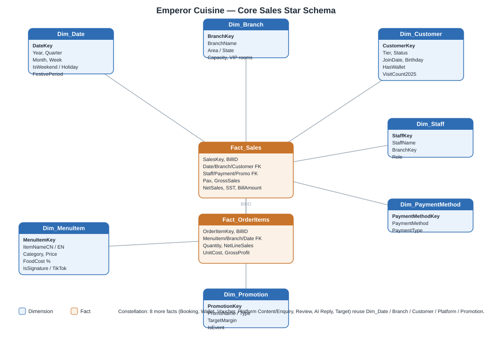

```text
┌────────────────────────────────────────────────────────────────────────────────────────┐
│                                   DIMENSION TABLES                                     │
├────────────────────┬───────────────────────────────────────────────────────────────────┤
│ Dim_Date           │ Marked Calendar table (2025), DayOfWeek, Weekend/Weekday, Holiday  │
│ Dim_Branch         │ 5 Branches (KL, Klang, Cheras, Puchong, Subang), Seats, Manager   │
│ Dim_Customer       │ 8,001 Records, Tier (Bronze to Corporate), JoinDate, Recency      │
│ Dim_MenuItem       │ 320 Dishes, Categories (Seafood, Dim Sum, Drinks), Cost, Price    │
│ Dim_Platform       │ 10 Channels (TikTok, IG, WhatsApp, Google Search, Facebook, etc.) │
│ Dim_Promotion      │ 10 Promo Packages, Discount Type, Minimum Spend, Event Flags      │
│ Dim_Campaign       │ Marketing Campaign Master, Channel, Budget, Launch Date           │
│ Dim_Staff          │ Front & Kitchen Staff, Role, Shift, Assigned Branch               │
│ Dim_Table          │ Table Numbers, Capacity (2/4/6/10-Top), Zone (Main Hall, VIP)     │
│ Dim_Voucher        │ Voucher Master, Campaign Name, Face Value, Redemption Terms       │
│ Dim_PaymentMethod  │ Credit Card, QR Pay, Cash, Membership Wallet                      │
└────────────────────┴───────────────────────────────────────────────────────────────────┘
                                       │ 1
                                       ▼ *
┌────────────────────────────────────────────────────────────────────────────────────────┐
│                                      FACT TABLES                                       │
├────────────────────┬───────────────────────────────────────────────────────────────────┤
│ Fact_Sales         │ Bill-level sales, gross/net amount, discount, member flag (45K+)  │
│ Fact_OrderItems    │ Item-level order lines, quantity, unit price, gross profit (376K+)│
│ Fact_Booking       │ Dining reservations, pax, status (Confirmed, Cancelled, No-Show)  │
│ Fact_PlatformEnquiry Inbound leads, customer match, channel, date, campaign key         │
│ Fact_PlatformContent Social posts, reels, impressions, views, link clicks              │
│ Fact_PlatformFollowers Follower snapshots by platform over chronological periods       │
│ Fact_AIReplyLog    │ 16,500 AI conversations, response latency, human handover flag    │
│ Fact_Review        │ Customer reviews, ratings (1-5), sentiment classification, text   │
│ Fact_Target        │ Branch-level and month-level revenue targets (RM20M total)        │
│ Fact_Wallet        │ Prepaid wallet ledgers, top-ups, payments, running balance        │
│ Fact_Voucher       │ Voucher distribution and redemption records                       │
│ Fact_ActionPlan    │ Strategic initiatives, category, expected RM impact, priority     │
└────────────────────┴───────────────────────────────────────────────────────────────────┘
```

---

## 💻 Core DAX Formulas Catalogue

### 1. Headline Commercial Measures
```dax
Total Sales = 
SUM(Fact_Sales[BillAmount])

Total Target = 
SUM(Fact_Target[WeightedMonthlyTarget])

Target Achievement % = 
DIVIDE([Total Sales], [Total Target], 0)

Target Status = 
SWITCH(
    TRUE(),
    [Target Achievement %] >= 1.00, "🟢 On Track",
    [Target Achievement %] >= 0.95, "🟡 Watch",
    "🔴 At Risk"
)
```

### 2. Dining Reservation Intelligence
```dax
Total Bookings = 
COUNTROWS(Fact_Booking)

Confirmed Bookings = 
CALCULATE([Total Bookings], Fact_Booking[Status] = "Confirmed")

Booking Conversion % = 
DIVIDE([Confirmed Bookings], [Total Bookings], 0)

Cancellation % = 
DIVIDE(
    CALCULATE([Total Bookings], Fact_Booking[Status] = "Cancelled"),
    [Total Bookings],
    0
)

No Show % = 
DIVIDE(
    CALCULATE([Total Bookings], Fact_Booking[Status] = "No-Show"),
    [Confirmed Bookings],
    0
)
```

### 3. Customer Recency & Reactivation Segmentation
```dax
Visit Recency Bucket = 
SWITCH(
    TRUE(),
    Dim_Customer[DaysSinceLastVisit] <= 30, "0-30 Days",
    Dim_Customer[DaysSinceLastVisit] <= 60, "31-60 Days",
    Dim_Customer[DaysSinceLastVisit] <= 90, "61-90 Days",
    Dim_Customer[DaysSinceLastVisit] <= 180, "91-180 Days",
    "180+ Days"
)
```

### 4. AI Automated Customer Service Evaluation
```dax
AI Efficiency Score = 
(0.50 * [AI Success %]) + 
(0.30 * [AI Booking Conversion %]) + 
(0.20 * (1 - [AI Human Takeover %]))
```

---

## 💡 Key Business Findings & Strategic Action Plan

Across all 24 pages, the analytical engine synthesized **5 high-leverage commercial challenges** into a prioritized **Management Action Plan recovering RM799,562 in revenue**:

| Operational Focus | Observed Evidence | Root Cause Rationale | Strategic Action Plan | Expected Impact |
| :--- | :--- | :--- | :--- | :---: |
| 🏰 **VIP Room Utilisation** | Weekday VIP room bookings drop to <25% in Cheras & Klang. | High-ticket rooms sit vacant on non-weekend evenings. | Launch corporate dining packages targeting industrial & office parks. | **RM341,172** *(43%)* |
| 🍛 **Weekday Lunch Traffic** | 11:00–14:00 Monday–Thursday accounts for only 8% of revenue. | Fixed kitchen overheads run idle without business lunch crowd. | Introduce high-velocity "Express Business Lunch Sets" (RM21.80). | **RM182,882** *(23%)* |
| 🥟 **Dim Sum Margin Leak** | RM3 Dim Sum special generated massive footfall but diluted margins. | Food cost exceeded 48% on promotional baskets without add-ons. | Mandatory drink and premium specialty dish bundle requirements. | **RM157,039** *(20%)* |
| 📱 **TikTok Conversion Gap** | TikTok generated 43M views (68% of reach) but minimal enquiries. | Top-of-funnel viral videos lacked clear booking calls-to-action. | Implement direct Click-to-WhatsApp booking incentives on viral reels. | **RM98,182** *(12%)* |
| ❌ **Cheras Table No-Shows** | Cheras branch experienced peak cancellation (22.6%) & no-shows (15.8%). | Large weekend reservations held without pre-commitment. | Introduce automated WhatsApp deposit reminders 24 hours prior. | **RM20,287** *(2%)* |
| **Total Pipeline** | **Multi-Branch Operations** | **5 Core Optimization Pillars** | **Targeted Operational Interventions** | **RM799,562** |

---

## 📂 Repository Structure

```text
emperor-restaurant-analytics-powerbi/
│
├── rest_very_new_dashboard.pbix                               # Master 24-Page Interactive Power BI File (13.3 MB)
├── Emperor_Cuisine_PowerBI_Theme.json                         # Custom corporate color theme
├── Emperor_Restaurant_Power_BI_Complete_Project_Report_v4.docx # Full 32-chapter handover report
├── README_Data_Dictionary.md                                  # Complete schema and column catalog
├── Star_Schema_Diagram.svg                                    # Relational Star Schema Model Diagram
│
├── Dim_Branch.csv                                             # Dimensions: Branch locations and seats
├── Dim_Campaign.csv                                           # Dimensions: Marketing campaigns
├── Dim_Customer.csv                                           # Dimensions: 8,001 Loyalty member profiles
├── Dim_Date.csv                                               # Dimensions: Marked date calendar (2025)
├── Dim_MenuItem.csv                                           # Dimensions: 320 Dish items and food costs
├── Dim_PaymentMethod.csv                                      # Dimensions: Payment tenders
├── Dim_Platform.csv                                           # Dimensions: 10 Digital channels
├── Dim_Promotion.csv                                          # Dimensions: Promotional packages
├── Dim_Staff.csv                                              # Dimensions: Front-of-house staff
├── Dim_Table.csv                                              # Dimensions: Table layouts and zones
├── Dim_Voucher.csv                                            # Dimensions: Voucher rules
│
├── Fact_Sales.csv                                             # Facts: 45K+ Sales transactions (5.2 MB)
├── Fact_OrderItems.zip                                        # Facts: 376K+ Order items (Zipped for web upload, 6.5 MB)
├── Fact_OrderItems.csv                                        # Facts: Full uncompressed order items (31.3 MB)
├── Fact_Booking.csv                                           # Facts: 12.6K Reservation records
├── Fact_PlatformEnquiry.csv                                   # Facts: 12.2K Customer inbound leads
├── Fact_PlatformContent.csv                                   # Facts: Social content impressions & clicks
├── Fact_PlatformFollowers.csv                                 # Facts: Follower growth trajectory
├── Fact_AIReplyLog.csv                                        # Facts: 16.5K AI chatbot interactions
├── Fact_Review.csv                                            # Facts: 3.7K Customer feedback records
├── Fact_Target.csv                                            # Facts: Weighted monthly branch targets
├── Fact_Wallet.csv                                            # Facts: Customer digital wallet balances
├── Fact_Voucher.csv                                           # Facts: Voucher redemption ledgers
├── Fact_ActionPlan.csv                                        # Facts: Strategic revenue action plan
│
├── page_01_overview.png through page_24_management_action_plan.png # 24 Live dashboard visual screenshots
│
├── requirements.txt                                           # System prerequisites & Python libraries
├── .gitignore                                                 # Ignores temp files, Office locks (~$*), caches
└── README.md                                                  # Master project pitch deck & technical documentation
```

---

## 🚀 How to Run & Replicate

1. **Clone the Repository:**
   ```bash
   git clone https://github.com/ravinder0710/emperor-restaurant-analytics-powerbi.git
   cd emperor-restaurant-analytics-powerbi
   ```

2. **Open the Power BI Dashboard:**
   - Launch **Microsoft Power BI Desktop** (Latest 64-bit version recommended).
   - Open [`rest_very_new_dashboard.pbix`](rest_very_new_dashboard.pbix).
   - All 11 Dimension tables, 12 Fact tables, DAX measures, and Theme styles are pre-loaded.

3. **Navigate the 24 Pages:**
   - Use the left sidebar to navigate across all 24 operational modules.
   - Interact with slicers (Branch, Date, Platform, Member Tier, Priority) to explore real-time dynamic measure calculations.

---

## 👨‍💼 Author & Contact

**Ravinder Gupta**  
*Data Analyst | Business Intelligence & Hospitality Analytics Specialist*  

- 📍 **Location:** Gurugram (Delhi-NCR), India  
- 📧 **Email:** [iamravindergupta17@gmail.com](mailto:iamravindergupta17@gmail.com)  
- 🐙 **GitHub:** [github.com/ravinder0710](https://github.com/ravinder0710)
